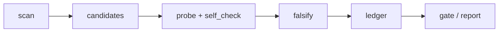

<p align="center">
  
</p>

<h1 align="center">bug-vet</h1>

<p align="center"><b>Prove a bug before you report it.</b></p>

<p align="center">
  <a href="https://github.com/zhengqiuyang/bug-vet/actions/workflows/ci.yml"></a>
  <a href="LICENSE"></a>
  <a href="https://www.python.org/"></a>
  <a href="CHANGELOG.md"></a>
</p>

<p align="center">
  <a href="#quickstart">Quickstart</a> ·
  <a href="#why-it-exists">Why it exists</a> ·
  <a href="#how-it-works">How it works</a> ·
  <a href="#proof">Proof</a> ·
  <a href="#integrations">Integrations</a> ·
  <a href="docs/USER_GUIDE.md">中文指南</a>
</p>

`bug-vet` hunts the bugs ordinary linters miss: a sibling provider quietly drops a kwarg, a parser eats a trailing backtick, a `Sequence` parameter is narrowed to `list`, a generator is drained twice. A promising candidate has to become a self-checked executable probe, survive a falsifier, and clear red/green evidence before it counts as a finding.

Zero runtime dependencies, Python 3.10+, stdlib-only MCP server. Everything runs locally: no account, no telemetry, no code leaves your machine.

## Quickstart

```bash
pip install "git+https://github.com/zhengqiuyang/bug-vet.git"

# Read-only scan. Artifacts land in the runs dir, never inside the target repo.
bug-vet scan --mode all /path/to/repo --name demo --runs-dir ~/.bug-vet-runs
bug-vet status demo --runs-dir ~/.bug-vet-runs
```

Working on `bug-vet` itself: `pip install -e ".[dev]"` then `pytest -q` (41 tests).

## Why it exists

Static rules find patterns; LLM review finds plausible stories; coverage finds executed lines. None of them prove that *this* input breaks *this* contract. `bug-vet` starts from a contract (docstring, type, sibling symmetry, round-trip pair), then demands a minimal reproduction that fails for the right reason.

| Approach | Typical output | Reproducible? | Rejects weak findings? |
|---|---|---|---|
| Rule-based linters | pattern matches | no | n/a |
| LLM code review | plausible explanations | no | inconsistently |
| Coverage | lines executed | no | n/a |
| **bug-vet** | contract violation + probe | **yes, exit 0/1** | **falsifier + fail-closed gate** |

## How it works



Discovery is read-only and produces leads, never findings. The discipline is **Hunter != Verifier**: a separate falsifier checks upstream compensation, surrounding tests, and probe vacuity. Evidence is ranked `doc < probe < test < published < runtime`; anything missing a `self_check()`, run in a different environment, or failing with an uncaught traceback stays `unknown` and blocks readiness.

## Proof

> [!TIP]
> ContractBench replays 12 real bugs that were merged upstream. Pre-fix recall@5 is **10/12 (83.3%)**, with **7/12 at rank #1**; the post-fix negative control clears **11/11**; zero environment false positives. Full table in [BENCHMARK.md](bench/reports/BENCHMARK.md), rerun with `bug-vet bench --cases bench/cases.json`.

The suite covers `instructor`, `litellm`, `pr-agent`, `headroom`, `DeepTutor`, `haystack`, `mujoco`, `home-assistant/core`, and `testsprite-cli`.

## What it finds

| Scan | Catches |
|---|---|
| `siblings` | ABC subclass kwarg omission, `<entity>_to_<provider>` guard asymmetry, `*_API_BASE` vs `*_API_KEY` dispatch gaps, TS/JS validator omissions |
| `parser_meta` | naive fence stripping, incomplete SSE/line-ending terminators, unescaped Markdown round-trips, unsafe `.get(k, {}).items()` |
| `contracts` | `Sequence`/`Mapping` narrowed to `list`/`dict`, idempotent `register*` self-eviction, unguarded `coordinator.data[key]` |
| `claims` / `roundtrip` | docstring and doc-example contracts, inverse-pair round-trips, unwired callsites, doc drift |

Five compiled playbooks (`bug-vet playbook --list`) describe each family's probe recipe and the falsification traps to check first.

## Integrations

`bug-vet` is agent-agnostic: the CLI and the MCP server write to the same evidence ledger, so any coding agent can run a full audit.

| Host | How to connect |
|---|---|
| Any MCP client (Claude Code, Cursor, Codex, dsh, custom agents) | run `bug-vet mcp` over stdio |
| Antigravity (optional) | `bug-vet setup --client antigravity --apply` installs a native bundle |

```json
{ "mcpServers": { "bug-vet": { "command": "bug-vet", "args": ["mcp"] } } }
```

The server exposes nine tools: `bv_scan`, `bv_playbook`, `bv_probe`, `bv_falsify`, `bv_shrink`, `bv_verify`, `bv_ledger`, `bv_gate`, `bv_report`.

The optional Antigravity bundle packages the same workflow as three on-demand skills, a `bug-vet-hunter` writer plus a read-only `bug-vet-falsifier`, always-on rules, and two `PreToolUse` hooks that reject vacuous probes under `probes/` and force confirmation before `git push`, PR creation, or package publishing.

<details>
<summary><b>CLI workflow</b></summary>

| Command | Purpose |
|---|---|
| `bug-vet scan --mode all <repo> --name <run>` | run every discovery oracle |
| `bug-vet ledger <run> --promote 1` | promote a ranked candidate into the ledger |
| `bug-vet new-probe <run> --claim <id>` | scaffold a probe that must define `self_check()` |
| `bug-vet probe <run> --cwd <repo>` | execute probes, record evidence, settle obligations |
| `bug-vet falsify --check-vacuity <probe>` | audit a probe for fake-green patterns |
| `bug-vet baseline <run>` / `bug-vet verify <run>` | snapshot pre-fix, compare post-fix (red → green) |
| `bug-vet gate <run> --require-verification` | fail-closed readiness verdict |
| `bug-vet report <run> --formats markdown,json,sarif` | REPORT.md, findings.json, SARIF 2.1.0, PR.md |

</details>

## Limits

> [!WARNING]
> `bug-vet` produces evidence, not fixes. Each candidate still needs a human- or agent-written probe, and static heuristics miss dynamic contracts, runtime configuration, and cross-language call graphs. The hooks only guard file writes: a probe created by a shell heredoc bypasses them.

## Docs

- [User guide (中文)](docs/USER_GUIDE.md): full CLI/MCP walkthrough and plugin setup.
- [Benchmark](bench/reports/BENCHMARK.md): per-case recall and post-fix control.
- [Changelog](CHANGELOG.md): what changed in each release.
- [License](LICENSE): MIT.

Issues and PRs are welcome. If you point `bug-vet` at a repository, please keep the run artifacts outside it (`--runs-dir`) so the target tree stays clean.
